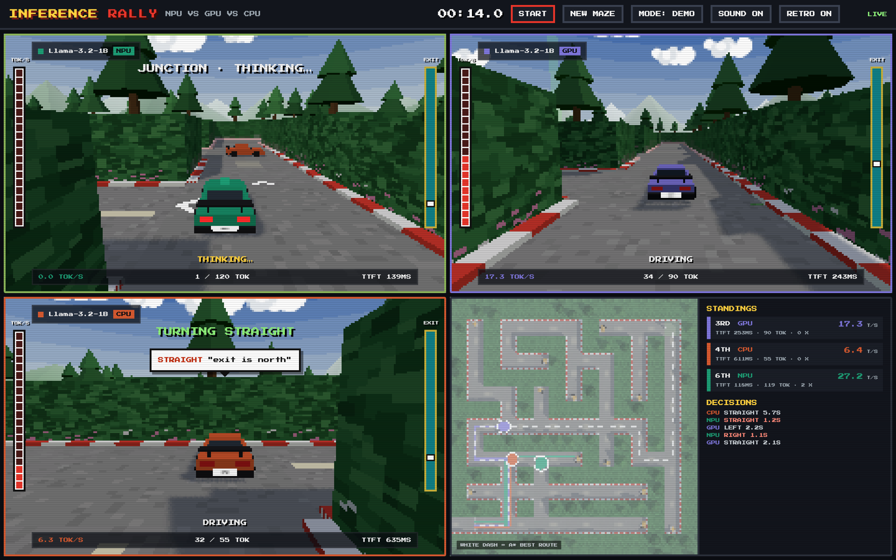
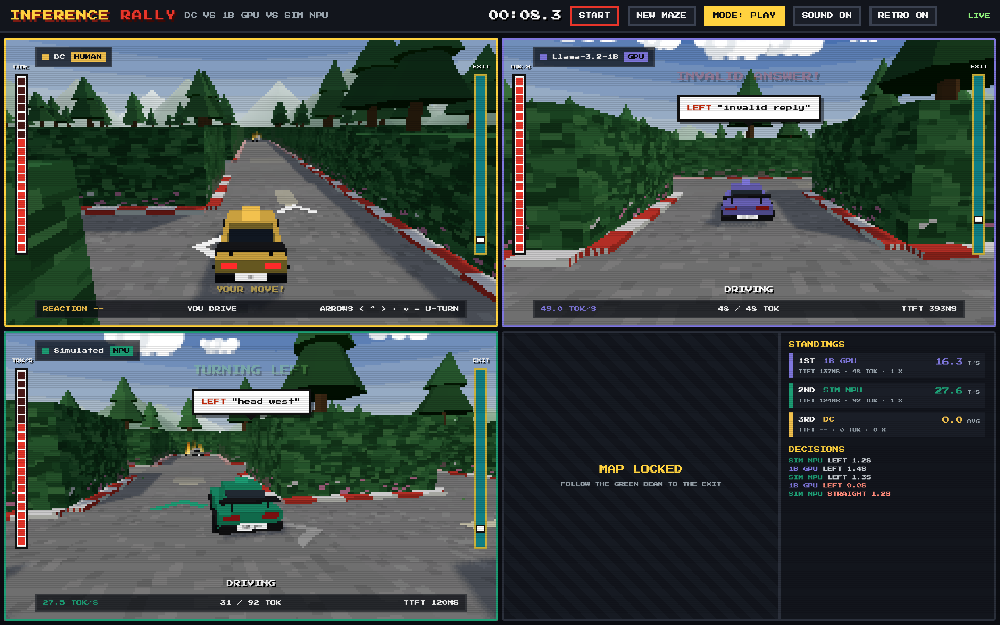
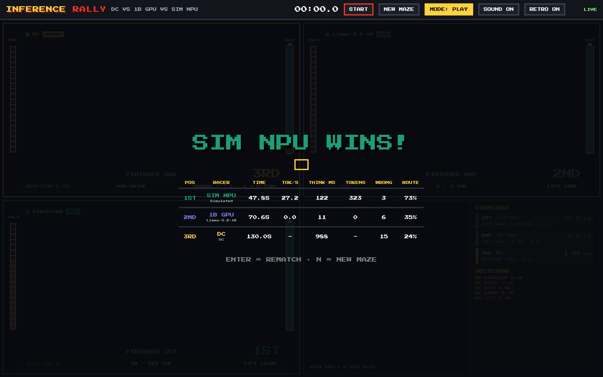

# Inference Rally

> On-device AI models race taxis through a 3D maze. Every turn is a decision; every second is compute.

ExecuTorch Hackathon — Compute Track (Copilot+ PC, Snapdragon X Elite).
Each racer is the same (or a different) model on a different compute unit — **NPU vs GPU vs CPU**.
At every junction the model is asked *left, right or straight?* and its car **waits while it thinks**,
so faster on-device inference visibly wins.

See **[docs/PLAN.md](docs/PLAN.md)** for the plan and architecture, and
**[docs/CODING_STANDARDS.md](docs/CODING_STANDARDS.md)** for coding rules.

## Demo video

[](https://youtu.be/c1g9Ugve1Pw)

▶️ **[Watch the demo on YouTube](https://youtu.be/c1g9Ugve1Pw)**

## Screenshots


| PLAY mode: you vs Llama-3.2-1B on the GPU | Race results |
|---|---|
|  |  |

## Two modes

| Mode | Racers | Needs |
|---|---|---|
| **DEMO** (default) | Simulated NPU vs GPU vs CPU — realistic speeds and mistakes | nothing |
| **PLAY** | **DC (you, arrow keys)** vs **Llama-3.2-1B on the M1 GPU** (real, via llama.cpp) vs a simulated racer | llama.cpp running |

Switch with **G** (or the MODE button). Lineups live in `racers.yaml` (`demo`, `play`, `snapdragon`).

## Quick start (Mac)

```bash
# 1. Python game server (once)
python3 -m venv .venv && source .venv/bin/activate
pip install -e ".[dev]"

# 2. Frontend (once)
cd frontend && npm install && cd ..

# 3. Run server (:8000) + UI (:5173)
./scripts/dev.sh
```

Open <http://localhost:5173> and press **Enter**.

### PLAY mode: real model on your Mac

```bash
brew install llama.cpp            # once
./scripts/start_models_mac.sh     # second terminal; first run downloads the model (~0.8 GB)
```

Then press **G** in the game (MODE: PLAY) and **Enter**. If the model isn't running, its car shows
"MODEL OFFLINE" and keeps going with fallback moves.

In PLAY mode the overview map is locked until you finish — like the models, you only know where the
exit is (follow the green beam).

### Controls

| Key | Action |
|---|---|
| Enter | Start / rematch (same maze) |
| N | New random maze |
| G | Switch DEMO / PLAY |
| ← ↑ → | Drive at a junction (PLAY): left / straight / right |
| ↓ | U-turn (PLAY) |
| M | Sound on/off |
| P | Retro pixels on/off |
| 1 / 2 / 3 | Focus one racer full screen |
| 0 / Esc | Back to split screen |

## Layout

- `src/inference_rally/` – Python game server
  - `maze.py` seeded maze + A* · `race.py` race engine · `deciders.py` racers' brains: simulated, real model (OpenAI-compatible), human
  - `prompts.py` junction prompt + reply parsing · `metrics.py` TTFT / tokens/sec timing
  - `models.py` typed config + event schema · `server.py` Starlette + Server-Sent Events
- `frontend/` – Three.js split-screen game (Vite)
  - `world/` maze, scenery, procedural pixel textures · `cars/` car model, driving, option arrows
  - `render/` split-screen viewports, overview map · `hud/` HUD, leaderboard, overlays · `audio/` chiptune synth
- `racers.yaml` – race settings and racer profiles (`demo`, `play`, `snapdragon`)
- `tests/` – pytest suite (game logic runs offline with simulated racers)
- `models/` – exported `.pte` / `.gguf` models (git-ignored)
- `scripts/` – `dev.sh` runs server + UI · `start_models_mac.sh` runs llama.cpp for PLAY mode
- `docs/` – plan, architecture, coding standards

## Demo build (single process)

```bash
cd frontend && npm run build && cd ..
python -m inference_rally.server   # serves the built UI at http://localhost:8000
```

## Checks

```bash
ruff check . && ruff format --check . && mypy src && pytest
```
