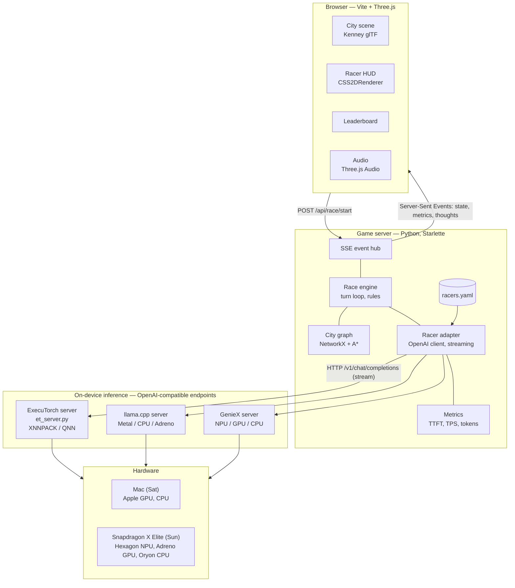
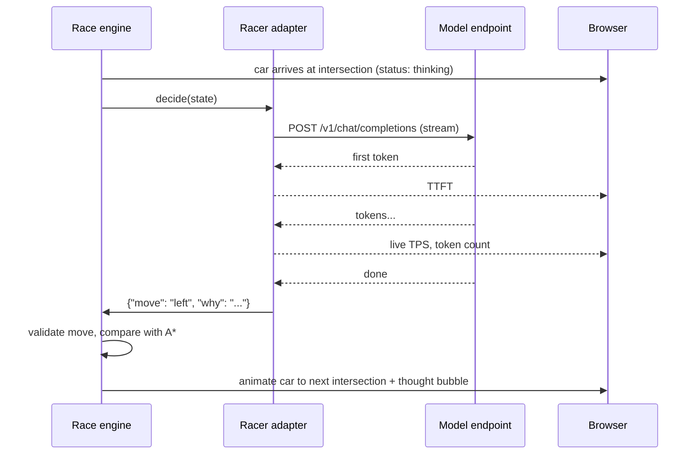

# Inference Rally — Project Plan

> Local AI models race taxis through a 3D city. Every turn is a decision; every second is compute.

**Hackathon:** ExecuTorch Hackathon — Compute Track (Copilot+ PC, Snapdragon X Elite)
**Timeline:** Fri 10/16 UI on Mac (simulated racers) · Sat 10/17 Snapdragon: inference + backend · Sun 10/18 hackathon

---

## 1. Goal

Show, visually and live, how different on-device models (and different compute units) **make decisions** and **how fast they make them**.

- Each racer = one model on one compute unit (NPU / GPU / CPU).
- All racers start at the same spot, same city, same destination.
- At every intersection the racer's model is asked: *left, right, or straight?*
- While the model thinks, its taxi **waits at the intersection** — slow inference visibly loses the race.
- Floating HUD above every taxi: model, device, live tokens/sec, tokens used, status.

### Race modes

| Mode | What changes | What it shows |
|---|---|---|
| **Device race** (headline demo) | Same model on NPU vs GPU vs CPU | Compute speed: the NPU taxi wins on latency |
| **Model race** | Different models, same device | Decision quality: wrong turns, path efficiency |
| **Runtime race** (stretch) | Same model, ExecuTorch vs llama.cpp | Runtime efficiency |

---

## 1b. Game view (decided 10/16)

- **3D arcade racer, chase camera** low behind each car (retro arcade style, not top-down).
- **Maze**: grid road network walled by hedges/trees/buildings — models can't see the exit; every junction is a decision.
- **Retro look**: Three.js rendered at low internal resolution, upscaled with nearest-neighbor (crisp pixels), pixel font (Press Start 2P), fog, painted sky + hills, red/white curbs.
- **Layout**: 2×2 split screen — 3 racer chase-cam panes + 1 overview pane (top-down maze minimap + leaderboard).
- **HUD per pane**: left red segmented bar = live tokens/sec · right teal bar = progress to exit · top banner = events (Junction ahead / Thinking… / Wrong turn! / Dead end) · bottom = tokens used, model, device, position.
- **Obstacles**: roadblocks, dead ends marked by a burning wreck, finish gate at the exit.
- **Assets**: Kenney Car Kit, Nature Kit, City Kit (Roads) — CC0.

## 2. Gameplay rules

- Maze = grid of junctions (nodes) and roads (edges), generated from a seed so every racer gets the identical maze.
- Obstacles: roadblocks, one-way streets, red lights (cost a short wait).
- Destination: a pickup marker; the model knows its compass direction and distance, not the full map (fog of war).
- **A\* ghost car** drives the optimal route as the reference "perfect player".
- Decision prompt is small and identical for all racers, `temperature=0`, short `max_tokens`.
- Model answers JSON: `{"move": "left", "why": "destination is west"}` → `why` shows in a thought bubble.
- Invalid answer / illegal move → counts as a mistake, car takes a fallback move.
- Race ends when all racers arrive or a time/step limit hits.

### Decision prompt (draft)

```
You are driving a taxi to a pickup point.
Position: intersection (4,2). Heading: north.
Destination: 3 blocks west, 2 blocks north.
Options:
 - left (west): open road
 - straight (north): ROADBLOCK
 - right (east): one-way, wrong direction
Reply with JSON only: {"move": "left|straight|right", "why": "<max 8 words>"}
```

---

## 3. Metrics

| Metric | How it is measured | Shown where |
|---|---|---|
| TTFT (time to first token) | Timed by our client on the stream | HUD + leaderboard |
| Tokens/sec | completion tokens ÷ (last token − first token) | HUD (live) + leaderboard |
| Tokens per decision / total | `usage` field, else count streamed chunks | HUD + leaderboard |
| Decision latency | request sent → move parsed | Leaderboard |
| Wrong turns / invalid moves | Compared to A* next step / rule check | HUD flash + leaderboard |
| Path efficiency | A* optimal length ÷ actual length | Final results |
| Finish time & place | Game clock | Podium screen |
| CPU load (stretch) | `psutil` | Leaderboard |

All timing is done by **our own client**, so numbers are comparable across ExecuTorch, llama.cpp and GenieX.

---

## 4. Architecture



### Key design decision: every racer is an OpenAI-compatible endpoint

The game server never knows *which* runtime is behind a racer. Switching from Mac to Snapdragon is only a `racers.yaml` change:

```yaml
racers:
  - name: Llama-3.2-1B
    device: NPU
    runtime: executorch
    base_url: http://127.0.0.1:8101/v1
    model: llama3_2_1b_qnn
    color: "#1D9E75"
  - name: Llama-3.2-1B
    device: CPU
    runtime: executorch
    base_url: http://127.0.0.1:8102/v1
    model: llama3_2_1b_xnnpack
    color: "#D85A30"
  - name: Llama-3.2-1B
    device: GPU
    runtime: llama.cpp
    base_url: http://127.0.0.1:8103/v1
    model: llama-3.2-1b-q4_0
    color: "#7F77DD"
```

ExecuTorch has no built-in OpenAI server, so we write a thin wrapper, `et_server.py`, that loads a `.pte` with the ExecuTorch LLM runner and exposes `/v1/chat/completions` with streaming.

### One decision turn (sequence)



---

## 5. Tech stack

| Layer | Choice | Why |
|---|---|---|
| Inference (primary) | **ExecuTorch** — XNNPACK (CPU) on Mac and Snapdragon, **QNN backend (Hexagon NPU)** on Snapdragon | It's an ExecuTorch hackathon; QNN backend is verified on Windows on Snapdragon X Elite |
| Inference (fallback / comparison) | llama.cpp `llama-server` (Mac: Metal, Snapdragon: CPU/Adreno OpenCL) and Qualcomm GenieX | Proven, OpenAI-compatible, same GGUF everywhere |
| Models | Llama 3.2 1B / 3B, Qwen3 small; `.pte` for ExecuTorch, Q4_0 `.gguf` for llama.cpp | Small = sub-second decisions |
| Model client | `openai` Python SDK (streaming) | One client for every runtime |
| Game server | Starlette + sse-starlette, Uvicorn, Pydantic, asyncio | Python, async racers in parallel; SSE = one-way event stream, auto-reconnect, no extra deps |
| City + pathfinding | NetworkX (graph + A*) | Built-in A*, easy obstacles |
| Frontend | Three.js + GLTFLoader + CSS2DRenderer, bundled with Vite | Nice 3D, crisp HUD labels, runs in any browser (no ARM64 package risk) |
| Assets | Kenney City Kit (Roads, Commercial), Car Kit, audio packs — CC0 | Free, consistent low-poly look |
| Audio | Three.js `AudioListener` / `PositionalAudio` | Already in the stack |
| Config | `racers.yaml` | Mac → Snapdragon is a config swap |

---

## 6. Repo layout (target)

```
Inference-Rally/
├── docs/PLAN.md                  ← this file
├── racers.yaml                   racer config (mac + snapdragon profiles)
├── pyproject.toml
├── src/inference_rally/
│   ├── server.py                 Starlette app + SSE event hub
│   ├── race.py                   race engine, turn loop, rules
│   ├── city.py                   seeded city graph, obstacles, A*
│   ├── racers.py                 racer adapter, streaming + metrics
│   ├── prompts.py                decision prompt + JSON parsing
│   ├── metrics.py                TTFT, TPS, tokens, efficiency
│   └── et_server.py              ExecuTorch .pte → OpenAI-compatible server
├── frontend/
│   ├── index.html
│   ├── src/  main.js scene.js cars.js hud.js leaderboard.js audio.js ws.js
│   └── public/assets/  models/  audio/
├── models/                       .pte / .gguf (git-ignored)
├── scripts/
│   ├── export_pte.sh             export LLM → .pte (XNNPACK, QNN)
│   ├── start_racers_mac.sh       launch model servers on Mac
│   └── setup_snapdragon.ps1      Windows ARM64 setup checklist
└── tests/
```

---

## 7. Timeline

### Fri 10/16 (today, Mac) — UI first, with simulated racers
- [x] Plan + architecture + coding standards
- [x] Lock the UI layout (2x2 chase-cam split screen + overview)
- [x] Freeze the **event schema** (`models.py`, streamed over Server-Sent Events)
- [ ] Frontend: Vite + Three.js city with Kenney assets, taxis, A* ghost car, camera
- [ ] HUD above each taxi (model, device, live TPS, tokens, status), thought bubbles
- [ ] Leaderboard, race controls, podium screen
- [ ] Sounds: countdown, engine, thinking tick, decision chime, wrong-turn buzzer, fanfare
- [x] Simulated racers (`runtime: simulated` in `racers.yaml`) stream realistic events, so the UI is fully testable without any model

### Sat 10/17 — hands on the Snapdragon laptop
- [ ] Hour 1: ARM64 Python + one model answering on the NPU (ExecuTorch QNN, else GenieX)
- [ ] Backend core: `city.py`, `racers.py`, `prompts.py`, `race.py`, `server.py`
- [ ] `et_server.py` (ExecuTorch → OpenAI-compatible), llama.cpp / GenieX for GPU and CPU racers
- [ ] Swap the UI from mock server to real server (same event schema)
- [ ] First real NPU vs GPU vs CPU race; record backup video

### Sun 10/18 — hackathon
- [ ] Tune prompt, race length, camera
- [ ] Rehearse 2-minute pitch + demo

## 8. Risks & mitigations

| Risk | Mitigation |
|---|---|
| ExecuTorch QNN `.pte` must be compiled for the target SoC with Qualcomm's QAIRT SDK; on Windows ARM64 the export step needs x64 Python (emulation) | Try export Saturday on an x64 host; ask organizers for prebuilt QNN LLM `.pte`; fallback NPU path = GenieX |
| ExecuTorch Python wheels / LLM runner on Windows ARM64 | `et_server.py` can wrap the C++ llama runner via subprocess instead of Python bindings |
| Slow LLM calls make animation choppy | Cars animate between intersections independently; only decisions block |
| RAM limits with several models at once | 1B–3B models at 4-bit; run racers sequentially per turn if needed |
| Venue Wi-Fi | Models, assets, wheels on USB |
| Something breaks live | Recorded backup video + replay mode from JSON logs |

---

## 9. Open questions

- Is ExecuTorch **required** for inference, or just encouraged? (Decides how much NPU work goes into ExecuTorch QNN vs GenieX.)
- Laptop specs at the venue (RAM, admin rights, preinstalled SDKs)?
- Any prebuilt ExecuTorch QNN models provided by organizers?

## 10. Coding standards

All code follows **[CODING_STANDARDS.md](CODING_STANDARDS.md)**: single-responsibility modules, type hints + Pydantic models, Google-style docstrings, *why*-comments, `logging` not `print`, ruff + mypy + pytest before every commit, JSDoc + Prettier/ESLint on the frontend.

## 11. Stretch goals

- AI race commentator: small local LLM writes one-liners, local TTS speaks them
- Vision racer: model gets a screenshot of the scene each turn
- Battery / power draw per racer
- Replay viewer for any past race
